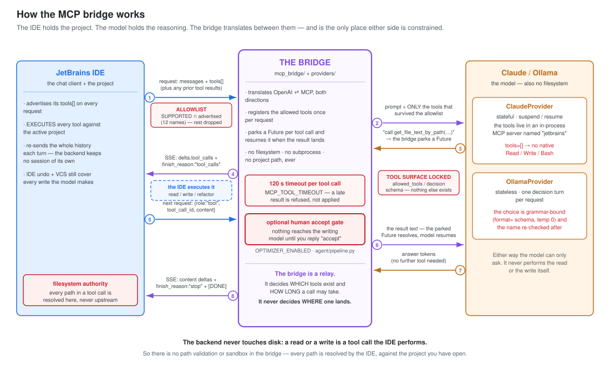
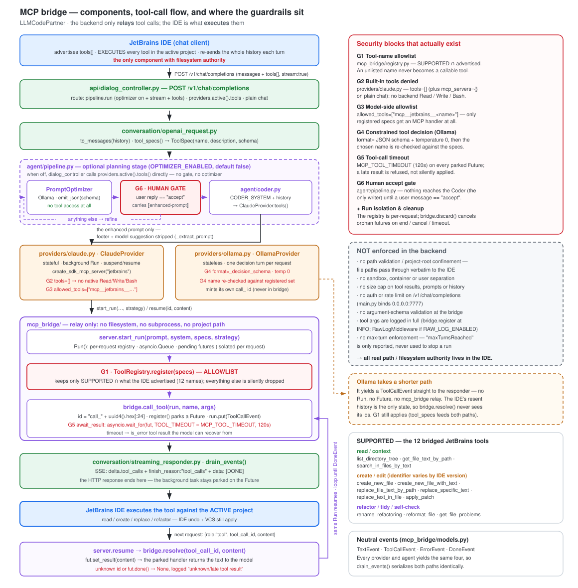

# LLMCodePartner

A minimal FastAPI backend that exposes an **OpenAI-compatible** API
(`POST /v1/chat/completions`, `GET /v1/models`) and bridges it to a **local
Claude/Codex** via the Claude Agent SDK (uses the installed `claude` CLI's
login — no `ANTHROPIC_API_KEY` required). The coder can both **read and edit**
the active JetBrains project through the IDE's own tools (see below).

Run it:

```bash
uv run main.py          # serves on http://0.0.0.0:7777
```

### Docker Compose

The Compose image includes Python 3.13, Node.js 22, and pinned OpenSpec, Codex,
and Claude Code CLIs. Copy `.env.example` to `.env`, adjust the provider settings,
then build and start the service:

```bash
cp .env.example .env
docker compose build
docker compose up -d
docker compose ps
```

The API is available at `http://localhost:7777`; its health check calls
`GET /v1/models`. Verify the packaged tools with:

```bash
docker compose exec codepartner openspec --version
docker compose exec codepartner codex --version
docker compose exec codepartner claude --version
```

### Native filesystem execution (multiple projects)

Registered projects are bind-mounted into the container under `/workspace`, and the
filesystem is the main execution path: the WP planner, coders, reviewers and chat
turns use Claude Code's and Codex's own file and shell tools in the project
directory, and OpenSpec artifacts are read and written on disk. IDE MCP stays
available for IDE-specific extras only (inspections, symbols, refactorings, run
configurations). Unregistered projects fail. Codex runs
without its own sandbox, so the container is the only boundary and every mounted
project is reachable. Register projects with
`scripts/register_project.py`, chain `compose.projects.yaml` through `COMPOSE_FILE`,
and check the binding with `/project`. Native edits are detected from a git
baseline and journaled for review; there is no undo. See
[docs/native-execution.md](docs/native-execution.md) for setup, modes, container
limitations and the smoke test.

### Task model routing

Start implementation with `/implement WP1` so its Work Package is planned and
approved first. The task's
complexity selects a configured candidate pool, vLLM Semantic Router recommends
one allowed model, and Code Partner starts Claude Code or Codex with the existing
JetBrains MCP tool bridge. agentgateway is attempted where the authenticated CLI
flow supports it, with direct CLI fallback retained. See
[model routing](docs/model-routing.md) for configuration and fallback behavior.

Claude and Codex credentials live in the named `agent-home` volume mounted at
`/home/codepartner`. Authenticate each provider once inside the container. Device
authentication is the recommended Codex flow for remote or headless machines:

```bash
docker compose run --rm codepartner claude auth login
docker compose run --rm codepartner codex login --device-auth
```

Verify both logins before starting the service:

```bash
docker compose run --rm codepartner claude auth status
docker compose run --rm codepartner codex login status
```

If Codex reports `Permission denied` while logging in after upgrading from an
older image, repair the existing credential directory once, then retry:

```bash
docker compose run --rm --user root codepartner \
  chown -R codepartner:codepartner /home/codepartner/.codex
```

Codex device authentication may need to be enabled in your ChatGPT security
settings or by your workspace administrator. Open the displayed URL in a browser
and enter the one-time code; do not share that code. The named volume remains after
container replacement and `docker compose down`, so refreshed credentials and CLI
settings survive rebuilds. `docker compose down -v` intentionally deletes that
volume and requires signing in again. The service runs as the non-root
`codepartner` user so the credential store remains writable.

Compose uses host networking because PyCharm's MCP server listens only on host
loopback. The API therefore listens directly on host port 7777 even though
`docker compose ps` does not display a published-port mapping. `OLLAMA_HOST`,
`MCP_PUBLIC_BASE` and the URL in `.codepartner/ide_mcp.json` can use
`127.0.0.1` from the container. No source project is mounted. On the first
request that needs MCP, the backend reads `.codepartner/ide_mcp.json` through
the current AI Assistant bridge, then connects to the configured PyCharm MCP
server for later project reads and writes. The file uses this shape:

```json
{
  "type": "streamable-http",
  "url": "http://127.0.0.1:64462/stream",
  "headers": {
    "IJ_MCP_SERVER_PROJECT_PATH": "/absolute/path/to/the/project"
  }
}
```

An optional Codebase Memory sidecar supplies bounded architectural context to
OpenSpec and Work Package planning, with a host-side refresh after passing WP
reviews. See [Codebase Memory setup](docs/codebase-memory.md).

The backend caches discovered tools by conversation for 30 minutes. Clients may
send a stable `conversation_id`; otherwise the backend returns its generated id
in `X-CodePartner-Conversation-ID` and associates the session with the bootstrap
tool call in resent chat history. The cache is local to one backend process.

For unattended deployments, provide `ANTHROPIC_API_KEY` or the applicable Codex
access token through a secret manager or runtime environment. Never copy credentials
into the image. `.dockerignore` excludes the local `.env` file.

- Capability diagnostics log tool names, schema-shape decisions, and call IDs only.
  Request bodies, prompts, credentials, and tool arguments are never logged.
- Tool-call timeout: `.env` `MCP_TOOL_TIMEOUT=120` (seconds).
- Tracing (opt-in): `.env` `OTEL_ENABLED=true` exports one OpenTelemetry trace per
  execution (routing, Claude/Codex runs, MCP tool calls; no prompts or source) to a
  separate OTel Collector + self-hosted Langfuse stack (`compose.observability.yaml`).
  See [docs/observability.md](docs/observability.md).
- LLM provider: `.env` `LLM_PROVIDER=claude|codex` (see Providers).
- Coder provider: `.env` `CODER_PROVIDER=claude|codex`, independent of `LLM_PROVIDER`.
- Turn classifier model: `.env` `OLLAMA_MODEL` (and `OLLAMA_HOST`), or `IMPLEMENT_INTENT_MODEL`.

## OpenSpec planning commands

Send `/spec <request>` through the chat endpoint to create a new, additive
OpenSpec change without starting implementation:

```text
/spec "implement authentication"
```

Each invocation creates a separate directory under `openspec/changes/` containing
`.openspec.yaml`, `proposal.md`, `design.md`, one or more capability delta
specifications, and `tasks.md`. A later `/spec` creates another change and never
replaces an earlier one.

Planning uses the explicit hierarchy **Epic → Work Package → Task**. An Epic
explains why an initiative exists, a WP is a complete demonstrable feature and
the primary acceptance/review boundary, and a Task is a bounded routed execution
instruction. The backend assigns stable IDs such as `EPIC1`, `WP1`, and
`WP1-T1`; IDs come from the catalog rather than model output. WP acceptance
criteria and required/preferred/optional/not-required validation expectations
form the reviewer contract. Tasks retain their dependencies, definition of done,
complexity, reasoning, context, and preferred capability.

`.codepartner/spec-index.json` stores the machine-readable catalog and
`.codepartner/tasks.md` is regenerated as a dashboard of every active work
package. The OpenSpec change files remain the planning artifacts.

Explain canonical work without modifying it, or refine it in a draft:

```text
/explain EPIC1
/explain WP1
/refine WP1
# discuss proposed changes in subsequent messages
/apply
```

`/refine` stores a conversation-scoped draft. Only `/apply` updates the existing
canonical object. Apply reconciles descendants without erasing task identity or
execution history; affected completed tasks are marked for re-execution and
obsolete tasks are cancelled. `/discard` drops the draft without writing anything.

### Modes (chat model picker)

`GET /v1/models` advertises one virtual model per mode. Pick one in the IDE chat
model dropdown; plain messages then follow that mode, while any message starting
with `/` keeps its normal one-shot meaning.

| Model | Plain message | Example |
|---|---|---|
| `dumb-router` | Default coding agent (unchanged behaviour) | — |
| `codepartner-spec` | Drafts a new OpenSpec change in the chat; later messages revise it. Nothing is written until `/apply`; `/discard` drops it. | `add password reset` |
| `codepartner-review` | Runs `/review` read-only. A message without a scope reuses the last scope named in the conversation. | `WP1: are tests missing?` |
| `codepartner-implement` | Plans a named Work Package before implementation. | `WP1: add tests` |

Replies to a pending implementation job (`yes`, `accept`, `retry review`, …) are always
handled first, whatever mode is selected. Spec-mode drafts use provisional IDs
(`WP1`, `WP1-T1`); final IDs are assigned when `/apply` saves the change.

Implement persisted tasks with the model-routing pipeline:

```text
/implement WP1
/implement EPIC1
/implement WP1: add MLflow tracking and keep the configuration injectable
```

`/implement` starts Work Package planning. An Epic selector queues its unfinished
Work Packages, each planned after the previous package completes. Individual task
selectors and `/run WP1-T1` direct the user to the parent Work Package. Optional guidance
must follow a colon, so task selection remains unambiguous. The backend creates a durable
implementation job after plan approval, routes each task only when it starts, and executes tasks
sequentially. For WP implementation, all tasks are assembled before one read-only
WP review evaluates the completed feature against its OpenSpec contract. Outcomes
are `PASS`, `BLOCK`, or `UNVERIFIED`: only concrete contract violations block;
tooling or evidence limitations remain review/infrastructure problems and do not
become coder failures. A failed task stops the job. IDE tool calls resume the
same routed provider. Existing jobs can resume and recover without replanning.

After every review attempt, chat shows the verdict, the actual coder and
reviewer models, the reviewer's reason, the evidence checked, and any remaining
gaps. For tasks requiring your decision, this explanation appears before the
three-choice interaction. A reviewer that could not run or could not verify the result
is shown as pending, not credited with a verdict. Each review attempt remains
in the operational review history.
When a task is completed, its final model attribution and approval reason are
also saved in the generated OpenSpec `tasks.md` and `.codepartner/tasks.md`
dashboard; the structured catalog preserves those details on regeneration.

`/implement` uses tools discovered from the conversation's
`.codepartner/ide_mcp.json` server. The bridge reads that file for initial
setup. Task completion depends on the reviewer judging the result against the
active task's description and task-level acceptance criteria, not on an MCP write
call. Work-package criteria are cumulative context for the package and cannot be
used to require implementation or tests assigned to later sibling tasks. Legacy
tasks without explicit task criteria use their description as the review criterion.
The review service reads claimed project artifacts from the mounted project and supplies a balanced, bounded source snapshot to the reviewer so
interfaces, factories, concrete implementations, and tests receive coverage.
Task mutation-journal paths are authoritative review evidence. A basename in a
coder report is reconciled to a unique journal path first; legacy or supplemental
claims use a project file search only after a literal not-found result and only when
the exact filename has one match. Missing or ambiguous paths remain pending.
Unreadable required deliverables keep the review pending; unreadable scratch,
temporary, debug, or ad-hoc artifacts are disclosed as optional limitations
unless the task objective or acceptance criteria explicitly require them.
The reviewer
may read further files with read-only tools. Its decision must identify the artifacts it assessed;
an unverified review stays pending and cannot become a confirmation question.
Reviewer runs are read-only native sessions (see docs/native-execution.md).
If Claude coded the task, Codex reviews it; if Codex coded it, Claude reviews
it. When only one provider is usable, a fresh read-only review uses that
provider. `/review` remains a separate manual read-only command, while `/spec`,
`/update`, and `/rework` only persist their own OpenSpec artifacts.

If a reviewer is unavailable or cannot inspect the project, the task stays
pending; reply `retry review` in the same chat after the issue is fixed. Reviewer
pairings and model tiers are configured in `config/model-routing.yaml`.
Codex routes may configure a separate `review_reasoning_effort`; this raises the
reviewer's reasoning budget without changing the effort used when that route codes.

Every reviewer issue is shown as formatted JSON with `problem`, `suggested_task`,
`approval_criteria`, `artifact_paths`, `owner`, and `reason`. CodePartner owns
evidence acquisition, the coder owns inconsistent project artifacts and missing
required execution, and the user owns only external infrastructure or judgment
gaps. Suggested tasks are advisory: the coder may choose a different implementation,
but the next review checks the stated problem and approval criteria.

Required journaled and task-declared source artifacts are read completely with
pagination before review. Verification commands run through the IDE dispatcher are
captured in an attempt-scoped evidence bundle under the container's temporary
CodePartner evidence directory (or `CODEPARTNER_EVIDENCE_DIR`). The bundle records
the command, raw output, hash, outcome, pytest collection count, totals, and node IDs
without adding evidence files to the target repository. Evidence from an earlier
coder revision is never reused for changed code.

Every implementation receives an independent review. If the reviewer finds a
blocking implementation issue, the coder revises and the reviewer checks the
result again, for up to three automatic revision rounds. Review approval or an
exhausted revision budget then uses one interaction: reply `accept` to keep the
implementation, or `submit to coder again: <additional prompt>` to keep the work
and begin a fresh three-revision coder/reviewer cycle. Accepting unresolved
findings is recorded as an audited user override. The older `try coder again` and
`accept anyway` forms remain aliases for in-flight chats. There is no undo: task
changes stay in the project (use git to revert them). Every change is journaled
with its path and post-write hash so the reviewer knows exactly what changed.

Coder narration is labeled as an untrusted claim and cannot set workflow status.
New summary, completion, evidence, verification, test-result, or ad-hoc runner
artifacts are blocked before creation unless the task explicitly declares them;
existing required documentation remains editable. An incomplete review caused by
unchanged CodePartner-owned evidence cannot be retried until that evidence changes.

If an IDE mutation's target cannot be identified, it is not executed. If a write
is applied but its post-image cannot be verified (or a native run moved `HEAD`),
the job continues and the reviewer is told which changes the journal could not
verify.

Review implemented work without granting write tools:

```text
/review WP1
/review WP1-T1: verify error handling and test coverage
```

Create corrective follow-up work when the implementation needs to change:

```text
/rework WP1-T1: credentials must be encrypted at rest
```

`/rework` creates a new additive OpenSpec change linked to its source tasks; it
does not erase completed-task history or automatically revert source files.

Use `/help` for the command list and `/man <command>` for detailed syntax:

```text
/help
/man implement
/man rework
```

The natural form `/update about US1-TASK1 and WP1-T2, ...` is also accepted and
normalized to canonical `WPn-Tn` IDs. An update loads the complete owning change
for context but may replace only the selected tasks. It preserves other tasks,
work packages, requirements, proposal, design, IDs, and completion states. One
update may currently target tasks from only one OpenSpec change.

For native runs, the backend host must have the `openspec` CLI on `PATH` (or set
`OPENSPEC_BIN` to its executable); the Compose image already includes it.
`/spec`, `/update`, `/run`, and `/implement` read `.codepartner/ide_mcp.json`
through the current AI Assistant request on first use, then use its
conversation-scoped server configuration. They do not require
`JETBRAINS_MCP_URL` or `JETBRAINS_MCP_PROJECT_PATH`. If a source-write/refactor
capability is absent or unsupported, implementation reports the missing capability;
`/implement` can still execute genuine research deliverables. If the artifact store cannot be
accessed, implementation cannot proceed. `/spec` and `/update` never execute
generated tasks.

## Providers

The LLM is pluggable via `LLM_PROVIDER` (`providers/`). **Every** provider can do
plain chat *and* drive the JetBrains tools through the same bridge — the only
difference is how a tool call is intercepted:

| Provider | Chat | Tool interception |
|---|---|---|
| `claude` | local `claude` CLI (Agent SDK) | in-process **MCP server**; the SDK calls a Python handler mid-generation |
| `codex` | local `codex` CLI (`codex exec --json`) | **MCP server over HTTP** (`mcp_bridge/mcp_http.py`): codex is a child process, so the run's tools are published at a private, run-scoped `/mcp/<token>` |

Codex runs with `-s read-only`, so its own shell/`apply_patch` cannot write: the
only way for it to change the project is the IDE-backed write tools. Its endpoint
lives exactly as long as the run — a finished run leaves nothing callable behind.
Neutral model tiers (`haiku`/`sonnet`/`opus`) map to codex models via `CODEX_MODEL_SIMPLE`/`_MEDIUM`/`_COMPLEX`
(fallback `CODEX_MODEL`, then the CLI default); `MCP_PUBLIC_BASE` is how the child
process addresses this app.

Both strategies converge on `mcp_bridge.bridge.call_tool` (mint id → emit a
`ToolCallEvent` → await the JetBrains result), so the events/SSE/resume layer and
JetBrains itself are identical regardless of provider. The engine (`mcp_bridge/`)
is provider-neutral — it imports no LLM SDK; the model-specific run strategy lives
in each `providers/<name>.py` and is injected by the controller.

## How Claude reaches the project (MCP bridge over JetBrains tools)

The backend has **no direct filesystem access** and never receives a project
path — no `cwd`, no absolute root. Claude/Codex reads **and edits** the **active
JetBrains project only through JetBrains' own tools**, advertised by the client in
the request `tools` array and executed inside the IDE. The backend never touches
disk itself: a write is a tool call that JetBrains applies (so IDE undo / VCS
still cover it).

Tools are whitelisted in `mcp_bridge/registry.py`, grouped by capability and granted
**per agent role** — there is no single global list. The groups list name variants
across JetBrains products/versions; `ToolRegistry.register` keeps only the
**intersection** of *the calling role's allowlist* and what the client actually
advertises, so a tool outside the role (or unadvertised) is simply ignored. Groups:

- **read / context** (`READ`) — `list_directory_tree`, `get_file_text_by_path`,
  `search_in_files_by_text`
- **write / edit** (`WRITE`) — `create_new_file` (and `create_new_file_with_text`),
  `replace_file_text_by_path` / `replace_specific_text` / `replace_text_in_file`,
  `apply_patch`
- **refactor / tidy / self-check** (`REFACTOR`) — `rename_refactoring`,
  `reformat_file`, `get_file_problems`

And who gets what (`ROLES`, resolved via `allowed_for(role)`):

| role | tools | why |
|---|---|---|
| `optimizer` (planner, reviewer and other read-only roles) | `READ` | it must never modify the repo |
| `coder` | `READ + WRITE + REFACTOR` | it applies the accepted change |

An **unrecognized** role fails closed to `READ` — a typo'd role name costs capability,
not safety. `allowed_for(None)` yields the full ceiling (`SUPPORTED`) for un-roled
callers. The role is fixed on the `Run` at `start_run`, so later tool-result resumes
stay inside the same allowlist.

> The exact write-tool identifiers your IDE advertises are version-specific.
> During the temporary bridge investigation, inspect `codepartner.*` DEBUG logs to
> confirm which names and schemas arrive from JetBrains. Remove the marked
> `##DELETE AFTER CORRECTION##` diagnostics after the correction is verified.

### Final flow

```
JetBrains Chat
  → OpenAI-compatible backend        (POST /v1/chat/completions, tools: [...])
    → Claude/Codex                   (tools exposed via an in-process MCP server)
      → MCP tool request             (Claude calls e.g. get_file_text_by_path or replace_file_text_by_path)
        → OpenAI-compatible tool call (streamed back: delta.tool_calls + finish_reason:"tool_calls")
          → JetBrains executes it against the ACTIVE project (read OR apply the edit)
            → tool result returns     (next request: {role:"tool", tool_call_id, content})
              → Claude/Codex resumes  (same execution continues; edits applied, answer streams out)
```

### The bridge in one picture

The IDE holds the project, the model holds the reasoning, and the bridge sits between
them translating OpenAI ⇄ MCP. It is also the only place either side is constrained —
so the security blocks live on its two borders, not in the model and not in the IDE.



- **Per-role allowlist** (`mcp_bridge/registry.py`) — `ToolRegistry.register` keeps only
  `allowed_for(role)` ∩ what the IDE advertised. The list is per agent, not global: the
  read-only roles get `READ`, the coder `READ + WRITE + REFACTOR`. A name outside the role
  never becomes a callable tool, so no handler is ever built for it.
- **Locked tool surface** (`providers/*.py`) — Claude gets `tools=[]` (no native
  Read/Write/Bash) and `allowed_tools=["mcp__jetbrains__…"]`; Codex runs `-s read-only`,
  so its own shell/`apply_patch` cannot write and its endpoint serves only the run's
  registry.
- **Timeout** (`mcp_bridge/bridge.py`) — `MCP_TOOL_TIMEOUT`, 120 s per parked future.
  A late result is refused rather than applied.

What the bridge deliberately does *not* do: confine paths to a project root, sandbox
anything, cap result size, or authenticate `/v1/chat/completions` — and it logs tool
arguments in full. There is nothing to sandbox, because every path is resolved by the
IDE against the project you have open.

<details><summary>Detailed version — full component map, both providers, all guardrails</summary>



</details>

Because the tool runs in the IDE, a call is bounced out to JetBrains and its
result arrives on the *next* HTTP request. The in-flight Claude execution is held
open in the meantime by an `asyncio.Future` keyed by `tool_call_id`.

### Notes

- **Per-request isolation:** each execution has its own `Run` with its own
  `ToolRegistry` (`mcp_bridge/registry.py`) — no global tool registry that could
  mix concurrent requests. Pending futures are keyed by unique `tool_call_id`.
- **Same tool name + args:** the MCP tool mirrors the name, description and JSON
  schema JetBrains advertised, so the emitted `tool_call` matches what the IDE
  expects.
- **Multiple sequential tool calls:** each tool call ends the current SSE
  response with `finish_reason:"tool_calls"`; the next request resumes the same
  run and surfaces the next call (or the final answer) — N round trips, one run.
- **Write/edit tools:** a `create_new_file` / `replace_*` / `rename_refactoring`
  call follows the **identical** round trip as a read — the IDE executes it and
  returns a `role:"tool"` result. The coder is prompted to apply changes with
  these tools rather than only pasting code (`agent/coder.py`).
- **Timeout / cleanup:** if JetBrains doesn't return a result within
  `MCP_TOOL_TIMEOUT`, the call fails with a clear timeout tool result; pending
  futures are cancelled and cleaned up on completion, cancellation, or timeout.
- **No supported tools → plain chat:** requests without a supported JetBrains
  tool behave as normal OpenAI chat (streaming or non-streaming); tool calling is
  disabled.
- **State:** in process memory only — no database, no auth, no IDE plugin.
- **Logs (`mcp_bridge`):** tools received · mcp tool registration · tool call
  emitted · tool result received · tool timeout · cleanup.
- **Usage & observability:** each run logs its token spend (`claude coder usage`:
  per-model `model_usage` + `total_cost_usd`). The terminal SSE event also carries an OpenAI-style `usage` chunk
  (`conversation/streaming_responder.py`).

All MCP/bridge code lives in the `mcp_bridge/` package
(`registry.py`, `models.py`, `bridge.py`, `server.py`). It is named `mcp_bridge`
rather than `mcp` on purpose: a top-level `mcp/` package would shadow the
installed `mcp` library the Claude Agent SDK imports.
