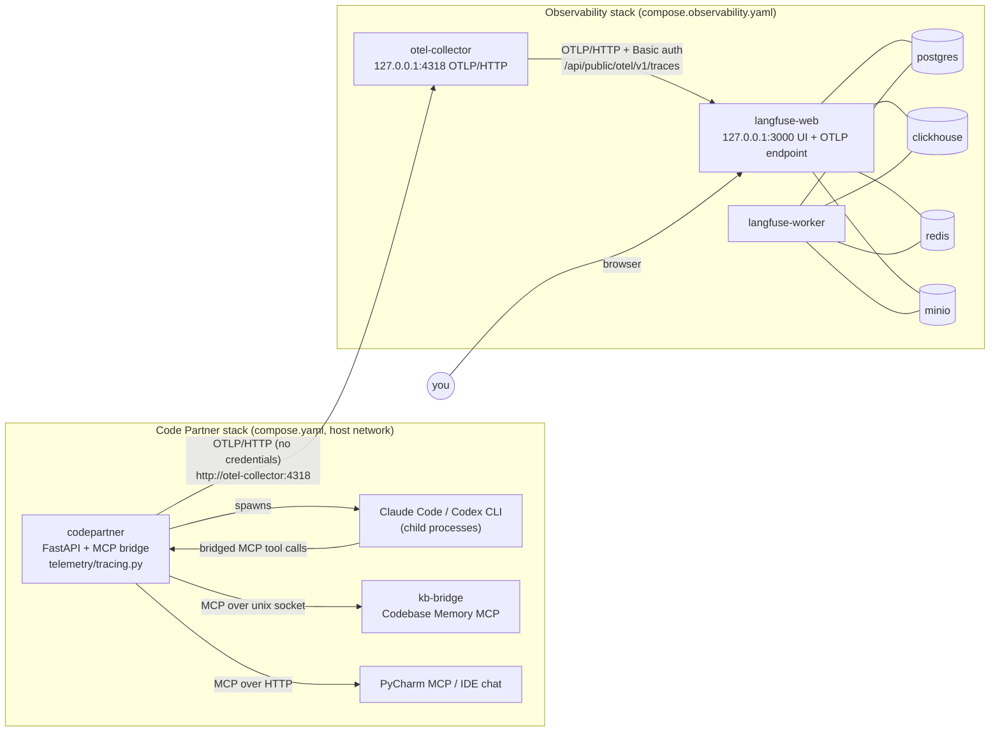

# Observability: OpenTelemetry and Langfuse

Code Partner can export one trace per execution to a self-hosted
[Langfuse v4](https://langfuse.com) through an OpenTelemetry Collector. The trace
shows the model routing decision, each Claude Code or Codex CLI run, every bridged
MCP tool call, and each step's duration, status, errors and token usage.

Tracing is optional and **off by default** (`OTEL_ENABLED=false`). It adds to the
local SQLite telemetry described in [telemetry.md](../telemetry.md) and does not
replace it. Telemetry never decides whether a task succeeds:
- spans are exported from a background thread through a bounded queue;
- a stopped or hung collector only causes dropped spans;
- process shutdown has a hard time bound.

This is the first stage of the Provenance Layer. It does not include artifact
lineage, a provenance database or a Security Gateway.

## Architecture



| Container | Responsibility |
|---|---|
| `otel-collector` | Core OpenTelemetry Collector distribution `0.162.0`. Receives OTLP from Code Partner. Applies a memory limiter, deletes transport and content attributes as defense in depth, and batches. Exports to Langfuse with bounded retries and a bounded in-memory queue. Holds the only copy of the Langfuse credential. |
| `langfuse-web` | Langfuse `4.50.0` UI, public API and OTLP ingestion endpoint. |
| `langfuse-worker` | Langfuse background processing (ingestion into ClickHouse). |
| `postgres`, `clickhouse`, `redis`, `minio` | Langfuse's own state. They are separate from Code Partner's SQLite and are never published on host ports. |

The stack follows Langfuse's official v4 `docker-compose.yml`, with these changes:
- exact image versions;
- a private `codepartner-observability` network;
- no host ports except the UI (loopback);
- Langfuse product telemetry off;
- the collector added.

The collector uses the core image because the core distribution already includes
every component used here. There is no persistent export queue: that would need the
contrib `file_storage` extension, which a local best-effort pipeline doesn't justify.
If the collector restarts while Langfuse is unreachable, queued spans are lost.

Code Partner runs with `network_mode: host`, so it can't join a Docker network. It
reaches the collector the same way it reaches its other sidecars: the collector
publishes on `127.0.0.1`, and `compose.yaml` maps `otel-collector` to `127.0.0.1`
through `extra_hosts`. The collector reaches Langfuse by container DNS
(`langfuse-web:3000`).

## Start and stop

The observability stack has its own lifecycle and Compose project name:

```bash
# Once: generate observability/.env (secrets, Langfuse keys, first login). Never committed.
python scripts/observability_init.py            # --port 3100 to move the UI

docker compose -f compose.observability.yaml --env-file observability/.env up -d
docker compose -f compose.observability.yaml --env-file observability/.env ps
docker compose -f compose.observability.yaml --env-file observability/.env down   # keeps data
# `down -v` also deletes all Langfuse data volumes.
```

The first start takes about a minute while Langfuse runs its migrations. Then:
- Langfuse UI: `http://localhost:3000`
- `curl -s localhost:13133`: collector health
- `curl -s localhost:3000/api/public/health`: Langfuse health

Turn tracing on in Code Partner by setting `OTEL_ENABLED=true` in `.env`, then
recreate the service (`docker compose up -d codepartner`). Turn it off with
`OTEL_ENABLED=false`. Code Partner behaves identically either way, and still works
when the observability stack is stopped.

## Configuration

Code Partner (`.env`; see `.env.example`). These are standard OpenTelemetry
variables except `OTEL_ENABLED` and `OTEL_SHUTDOWN_TIMEOUT_SECONDS`:

| Variable | Default | Meaning |
|---|---|---|
| `OTEL_ENABLED` | `false` | Master switch. When false, the SDK is not installed and every tracing call is a no-op. |
| `OTEL_SERVICE_NAME` | `code-partner` | Resource `service.name`. |
| `OTEL_EXPORTER_OTLP_ENDPOINT` | `http://localhost:4318` | Collector base URL. In Docker use `http://otel-collector:4318`. |
| `OTEL_EXPORTER_OTLP_PROTOCOL` | `http/protobuf` | Only HTTP is used. |
| `OTEL_EXPORTER_OTLP_TIMEOUT` | `5` | Seconds per export request. The Python SDK reads this value in seconds. |
| `OTEL_TRACES_SAMPLER` / `_ARG` | `parentbased_always_on` | For example `parentbased_traceidratio` with `1.0`. |
| `OTEL_BSP_MAX_QUEUE_SIZE` | `2048` | Bounded span queue. When full, spans are dropped. |
| `OTEL_SHUTDOWN_TIMEOUT_SECONDS` | `5` | Hard bound on flush plus shutdown at exit. |
| `OTEL_RESOURCE_ATTRIBUTES` | — | For example `deployment.environment.name=local`. |

Code Partner never needs Langfuse keys. The observability stack (`observability/.env`)
holds them:
- `LANGFUSE_PUBLIC_KEY` / `LANGFUSE_SECRET_KEY` (seeded into the project at first start);
- `LANGFUSE_OTLP_AUTH = base64(public:secret)` for the collector;
- `LANGFUSE_BASE_URL`, `LANGFUSE_PORT`, `LANGFUSE_INIT_*`;
- database, cache, object-store and NextAuth secrets.

The collector sends `x-langfuse-ingestion-version: 4`, which Langfuse requires for
immediate ingestion of directly sent OTLP data.

## Langfuse setup and API keys

`scripts/observability_init.py` sets up Langfuse's headless initialization. It
creates the `Code Partner` organization and project, its API key pair, and the first
user. The script prints the login, which is also stored in `observability/.env`.
Nothing else is required.

To rotate or create keys by hand:
1. Open the project in the Langfuse UI → **Settings → API Keys → Create new API keys**.
2. Put the pair in `observability/.env` as `LANGFUSE_PUBLIC_KEY` and `LANGFUSE_SECRET_KEY`.
3. Set `LANGFUSE_OTLP_AUTH=$(printf '%s' "pk-lf-…:sk-lf-…" | base64 -w0)`.
4. Restart the collector: `docker compose -f compose.observability.yaml --env-file observability/.env up -d otel-collector`.

`LANGFUSE_INIT_*` only applies to an empty database. Changing it later has no effect.

## What a trace contains

```text
codepartner.execution               one per top-level Run (a command, chat turn or job)
├── codepartner.model.routing       coder routing (semantic router / fallback) or planner tier
├── codepartner.llm.execution       one per Claude Code / Codex CLI run (Langfuse: agent)
│   └── codepartner.llm.turn        provider-exposed turn (Langfuse: generation)
│       └── <tool name>             bridged MCP call during that turn
└── codepartner.execution           an orchestration Run nested in another (rare)
```

The root is the Run, not the HTTP request. A Run pauses for IDE tool round trips and
resumes on later requests, so one execution spans several requests and still forms
one trace.

Spans are created at four existing points:
- `mcp_bridge/server.py:start_run` and `_run`: the run lifecycle and its final status;
- the two providers, which mark their Runs as `llm`;
- `TaskExecutionService.execute` and `PlannerRoutingService.route`: routing;
- `mcp_bridge/bridge.py:_call_backend`: the single dispatch point for direct
  JetBrains, Codebase Memory and IDE-chat tools from both CLIs.

Each tool span is parented on the Run that issued the call, never on whatever context
is current. So a Codex tool call that arrives over HTTP in another task still lands
under its own `llm.execution`.

Key attributes, all exported through a strict allowlist:

| Span | Attributes |
|---|---|
| execution | `codepartner.execution.id` (Run id), `codepartner.session.id` / `langfuse.session.id` (conversation id), `codepartner.command`, `codepartner.execution.status` (`completed`/`failed`/`cancelled`), duration, tool-call, tool-error and error counts, provider, model, task/job/decision ids, `codepartner.routing.strategy`, `codepartner.diagnostic_trace_id`, Langfuse trace metadata and tags. |
| model.routing | kind (`coder`/`planner`), complexity, candidates, fallbacks, excluded models, selected provider/model, reasoning effort, strategy (`semantic-router`, `deterministic-fallback`, `planner-tier`), duration. **No** routing reason text. |
| llm.execution | provider, requested model, `codepartner.aggregate.*` run totals when reported, `codepartner.source.*` delivered-read counts and bytes, cost (Claude), native tool counts, status, terminal reason. Run totals are excluded from Langfuse generation usage so turn usage is counted once. |
| llm.turn | One span per Claude assistant message or Codex JSON turn, with sequence, run/job/task IDs, provider, model, `gen_ai.usage.*` when reported, tool-call counts, and `codepartner.turn.context_measurement`. Bridged tool spans are children of the active turn. |
| mcp.tool_call | `gen_ai.tool.name`, `mcp.method.name=tools/call`, `codepartner.mcp.server` (`jetbrains-ide`, `jetbrains-standalone`, `codebase-memory`, `codepartner-aci`), route (`direct`, `ide_bridge`, `refused`), status, mutating flag, argument key names, argument and result byte counts, duration, `error.type` (`tool_error`, `timeout`, `policy_refused`, `invalid_call`, `stopped` or an exception class). |

For Claude, `codepartner.turn.context_tokens` is the assistant message's total
input usage (uncached + cache read + cache write). It is labeled `input_proxy`:
it approximates the request context, not the exact occupied context window.
Codex `exec --json` reports usage for a whole submitted turn, potentially across
several internal model calls. Its context size and internal-call breakdown are
marked `unavailable`; no value is inferred from cumulative input usage. Missing
provider token fields are omitted rather than recorded as zero.

The provider Run records aggregate usage under `codepartner.aggregate.*` for
diagnosis. Only turn spans carry `gen_ai.usage.*` for Langfuse accounting.
The same Run span records first-read bytes, bounded previews, explicit complete
reads, explicit ranges, follow-up reads and preview-observation expansions under
`codepartner.source.*`; the
corresponding per-attempt values remain in `telemetry_aci_attempts.metrics_json`.
These are delivered-output measurements, not provider token savings. Historical
WP6 attempts have no such fields, and no post-change task comparison is available
until equivalent work runs on the new build.

### WP6 baseline and comparison

A read-only snapshot of the execution SQLite database on 2026-10-20 contained
19 provider runs for `WP6-T1` through `WP6-T6` across multiple jobs and attempts:
382 agent-interface calls, 59 searches, 184 read calls, 31 whole-file reads,
92 ranged reads, and 12,344,776 cache-read tokens. These totals cover all stored
WP6 attempts, so they differ from the previously reported latest-execution
figures. That database did not contain per-turn context measurements or complete
native-tool activity for those historical runs. `context_observations` recorded
one backend compression error and no applied compression for those WP6 rows.
For the latest WP6 execution, the inspected task-level reads were mostly unique:
T1 and T4 read 20 and 25 distinct files once, and every task reported zero
`repeated_source_reads`. Thus the run-local identical-read reference is a safety
net, not an evidenced explanation for lower cache-read usage. A bounded first
read targets a different pattern; whether it helps depends on how often agents
request more source and on subsequent provider turns.

For a before/after comparison, select the same work-package tasks and attempt
scope in `telemetry_aci_attempts`, `context_observations`, and Langfuse. Compare
turn count, tool and search/read counts, repeated reads, per-turn context proxy,
cumulative cache reads, compression outcomes, and completed verification. Report
workload or attempt differences alongside the measurements; do not assign a token
change to one optimization without matched evidence.

## Finding and correlating executions

- **By conversation:** Langfuse **Sessions** shows one session per Code Partner
  `conversation_id`, the value of the `X-CodePartner-Conversation-ID` header.
- **By execution id:** filter traces on metadata `execution_id = run_…`. Other
  metadata filters: `task_id` (for example `WP1-T2`), `job_id`, `decision_id`,
  `command`, `provider`, `model`, `status`. Tags carry the command and status.
- **From logs:** each traced Run logs
  `trace_started kind=… run_id=… execution_id=… otel_trace_id=…`. Open
  `http://localhost:3000/project/codepartner/traces/<otel_trace_id>`. In process, the
  id is also in `run.metadata["otel_trace_id"]`.
- **From local SQLite telemetry:** the schema is unchanged, so the rows don't store
  the OTel trace id. Use the identifiers they already have:
  - `telemetry_aci_attempts.run_id` is the provider Run's id, the `codepartner.run.id`
    attribute of its `llm.execution`;
  - `decision_id`, `task_id` and `job_id` match the trace metadata filters above.
- **From an error message:** Code Partner reports its diagnostic `trace_…` id in
  failures. It is exported as metadata `diagnostic_trace_id`.

## Validation

- `tests/test_tracing.py` (unittest, in-memory exporter) covers:
  - the root and LLM spans;
  - routing success and failure;
  - Claude (in-process MCP handler) and Codex (per-run HTTP MCP handler);
  - exact trace and parent ids across detached tasks, nested Runs, IDE round trips
    resolved by another request, and Codex callbacks from another task;
  - concurrent Runs;
  - tool error, timeout, refusal and exception classification, with identical results
    and exceptions passed through;
  - attribute allowlisting and the absence of secrets and source;
  - disabled tracing;
  - unreachable and hung collectors, with a bounded shutdown in-process and for a
    whole child process.
- `scripts/smoke_observability.py` runs a real execution in a one-off container and
  reads the trace back from Langfuse's v4 Observations API
  (`GET /api/public/v2/observations`):

  ```bash
  set -a; . observability/.env; set +a
  docker compose run --rm --no-deps -e OTEL_ENABLED=true -e LANGFUSE_BASE_URL \
      -e LANGFUSE_PUBLIC_KEY -e LANGFUSE_SECRET_KEY codepartner \
      python scripts/smoke_observability.py --mode native --project <registered project>
  docker compose run --rm --no-deps -e OTEL_ENABLED=true -e LANGFUSE_BASE_URL \
      -e LANGFUSE_PUBLIC_KEY -e LANGFUSE_SECRET_KEY codepartner \
      python scripts/smoke_observability.py --mode mcp --kb-project <Codebase Memory project>
  ```

  The two modes check different things:
  - `native`: a read-only native CLI run. It expects only `execution → llm.execution`,
    because native CLI tools are not individual spans.
  - `mcp`: real planner routing, then a provider Run whose only tools are the
    read-only Codebase Memory MCP tools. It expects `execution → model.routing` and
    `llm.execution → tool calls`.

## Troubleshooting missing telemetry

1. **Is tracing on?** Startup logs `tracing enabled service=… endpoint=…`. Without
   that line, `OTEL_ENABLED` is not `true` in the container
   (`docker compose exec codepartner env | grep OTEL`).
2. **Does Code Partner reach the collector?** Exporter warnings
   `Transient error … /v1/traces` mean it doesn't. Check:
   - `curl -s localhost:13133`;
   - the `otel-collector` `extra_hosts` entry;
   - `OTEL_EXPORTER_OTLP_ENDPOINT` (the base URL, without `/v1/traces`).
3. **Does the collector receive spans?** `docker compose -f compose.observability.yaml
   --env-file observability/.env logs otel-collector` prints one `Traces … spans: N`
   line per batch (debug exporter).
4. **Does the collector reach Langfuse?** Collector export errors with `401` mean
   `LANGFUSE_OTLP_AUTH` doesn't match the project keys. Connection errors mean
   `langfuse-web` is not healthy yet.
5. **Delayed traces:** Langfuse ingests asynchronously, which usually takes a few
   seconds. Without the `x-langfuse-ingestion-version: 4` header it can take
   minutes.
6. **Sampling:** a `traceidratio` sampler below `1.0` drops whole executions.
7. **Missing tokens:** usage only appears when the CLI reports it. Claude reports it
   on its final result, Codex on `turn.completed`. An interrupted run has none.

## Security and privacy defaults

- **No content is exported:**
  - no prompts or system prompts;
  - no tool arguments (only their key names and byte size) or tool results (only
    byte size);
  - no file paths or file contents;
  - no routing reasons;
  - no exception messages or stack traces (only a classification or exception class
    name);
  - no environment variables, headers or credentials.

  This stage has no opt-in content capture.
- **Strict allowlist:** every attribute passes the schema in
  `telemetry/tracing.py`. Unknown keys are dropped, and every value is checked
  against an enum, identifier pattern or numeric type, so free text can't pass. As a
  second layer, values that look like secrets (API keys, bearer tokens, JWTs,
  `key=`/`token=`/`password` patterns) are dropped. As a third, the collector
  deletes transport and content attributes such as `authorization` headers,
  `url.full`, `gen_ai.prompt`/`completion`, tool call arguments and results, and
  `langfuse.observation.input`/`output`.
- **No auto-instrumentation:** FastAPI and httpx aren't auto-instrumented. Request
  URLs include the private per-run Codex MCP token (`/mcp/<token>`), which must never
  leave the process.
- **Credentials:** Code Partner holds no Langfuse credentials. Only the collector
  container receives the Basic-auth value. `observability/.env` is created with mode
  `600` and is ignored by git and Docker.
- **Access controls:** telemetry observes outcomes after the existing registry, role
  allowlist, KB-first and refusal checks. It never changes a tool result, an
  exception, the sandbox or an access decision.
- **Future Security Gateway:** the `codepartner.security.*` attribute namespace is
  reserved for its policy decisions.

## Known limitations

- **CLI internals are opaque.** Claude Code and Codex CLI are child processes and are
  not instrumented. Their model calls and native tools (Read, Grep, Bash, edits)
  appear only as totals on `llm.execution` (`codepartner.native.tool_calls`). No
  trace context is passed into them, because neither forwards it to Code Partner's
  bridged tools. Bridged MCP calls are still traced, from the controlling process.
- **No server-side MCP spans.** The kb-bridge sidecar (network-less) and the IDE MCP
  servers are not instrumented, and no `traceparent` header is sent to them. Tool
  spans are client-side and measure the full call, including the IDE round trip.
- **Some calls are not tool spans.** Tool calls refused before backend dispatch
  (KB-first gating in `bridge.call_tool`) and ACI virtual tools answered from the
  observation cache (`codepartner_get_observation`) are not separate tool spans. The
  backend calls they trigger are.
- **Inline reviewer selection.** Reviewer selection is inline in the review service,
  not a routing span. Reviewer runs are still `llm.execution` spans, with the
  reviewer flag and model.
- **Pre-Run work.** Work done in an HTTP request before any Run starts, such as
  intent classification or plain chat streaming, is not traced.
- **Identifiers.** The execution id is the Run id (`run_…`), which the code still
  marks as a diagnostic identifier. If it is ever removed, the execution id needs
  another stable source.
- **Collector resilience.** The collector queue is in memory only, and the
  distroless collector image has no in-container liveness probe. The Docker
  healthcheck re-validates the configuration; use `:13133` for liveness.
- **One run per root.** A provider Run started outside any execution (ad-hoc chat
  turns, planner sessions started from a request) is its own trace. Its root and LLM
  spans cover the same interval.
